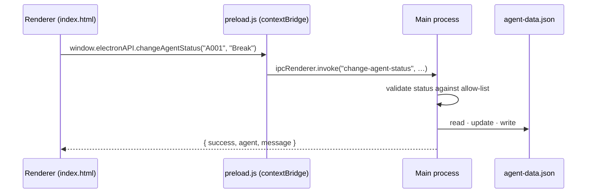
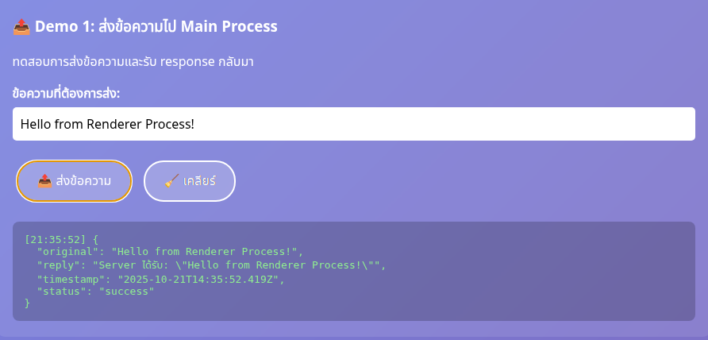
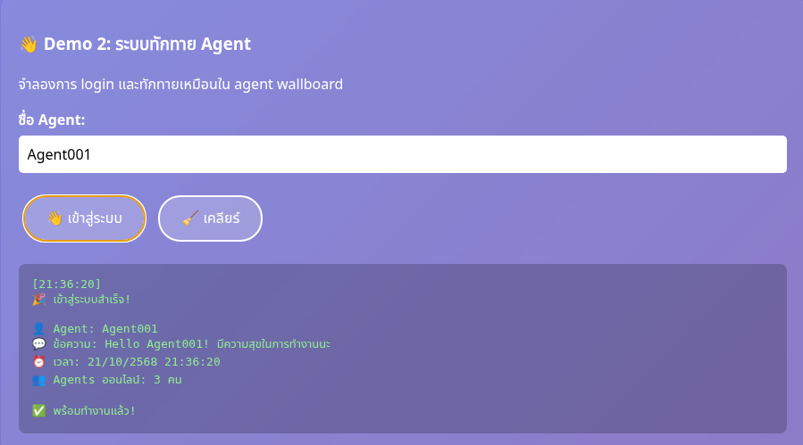
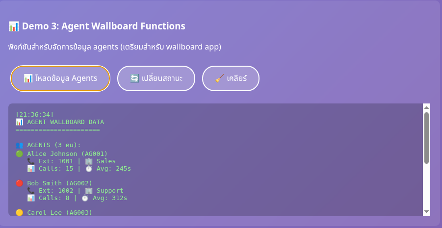
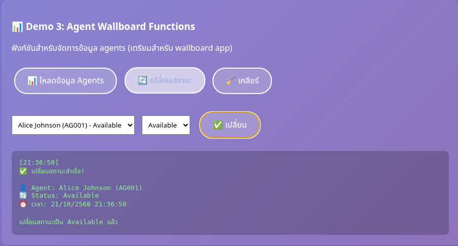

# Electron IPC — Secure Main ↔ Renderer Communication

**An Agent Wallboard desktop prototype showing how an Electron UI talks to the main process safely: a typed `contextBridge` API, request/response IPC, and input validation in the main process.**


> **ENGSE203, Lab 8.2: IPC Communication.** Previous: [8.1 First Electron app](https://github.com/tawan230666/Lab-8.1-Electron.js) · Next: [8.3 Native APIs](https://github.com/tawan230666/Lab-8.3-Native-APIs-System-Integration).
>
> ▶️ [Watch the demo video](docs/media/lab8-2-demo.mp4)

## How it works



**Security model**

- The renderer runs with `contextIsolation: true`, `nodeIntegration: false` and `sandbox: true`, so it has no access to Node.js or the file system.
- `preload.js` exposes exactly four functions on `window.electronAPI` and nothing else.
- The main process treats renderer input as untrusted: the agent status is checked against an allow-list before anything is written.
- `ipcMain.handle` / `ipcRenderer.invoke` give promise-based request/response calls with structured `{ success, error }` results.

## Demos

| # | Demo | IPC channel |
|---|---|---|
| 1 | Send a message and receive a JSON reply | `send-message` |
| 2 | Agent greeting with a random welcome message | `say-hello` |
| 3 | Load agents and change their status (persisted to JSON) | `get-agents`, `change-agent-status` |
| 4 | Process information panel | — |

| Send a message | Agent greeting | Load agents | Change status |
|---|---|---|---|
|  |  |  |  |

## Run

```bash
git clone https://github.com/tawan230666/Lab-8.2-IPC-Communication.git
cd Lab-8.2-IPC-Communication
npm install
npm start
```

> The demo video is stored with Git LFS; run `git lfs pull` after cloning to download it.

---

**Author:** Tawan Tiphkun (ธาวัน ทิพคุณ), 67543210033-6, [@tawan230666](https://github.com/tawan230666), Software Engineering, RMUTL Chiang Mai
